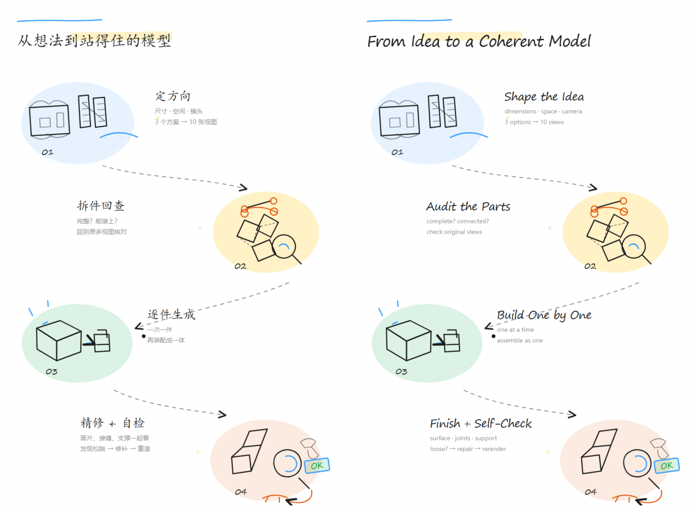
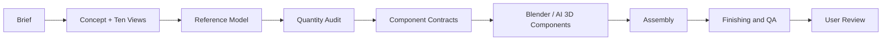
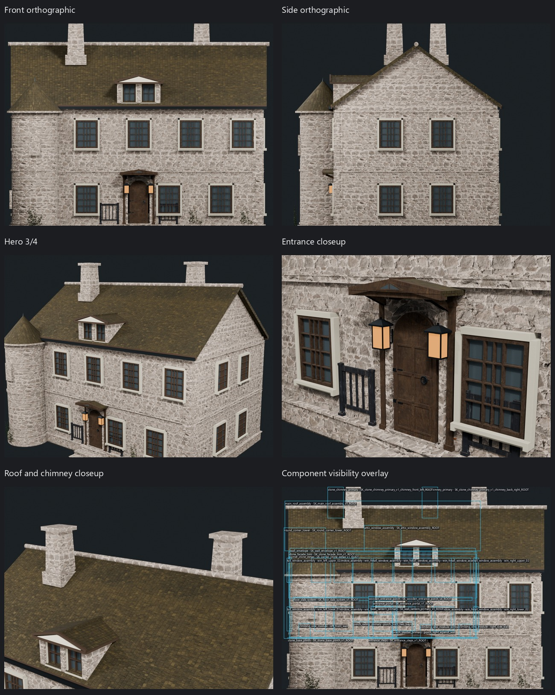
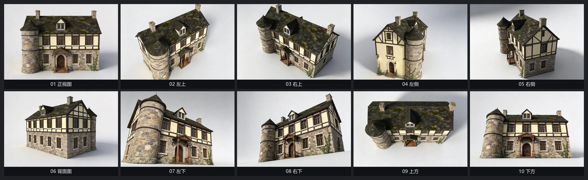
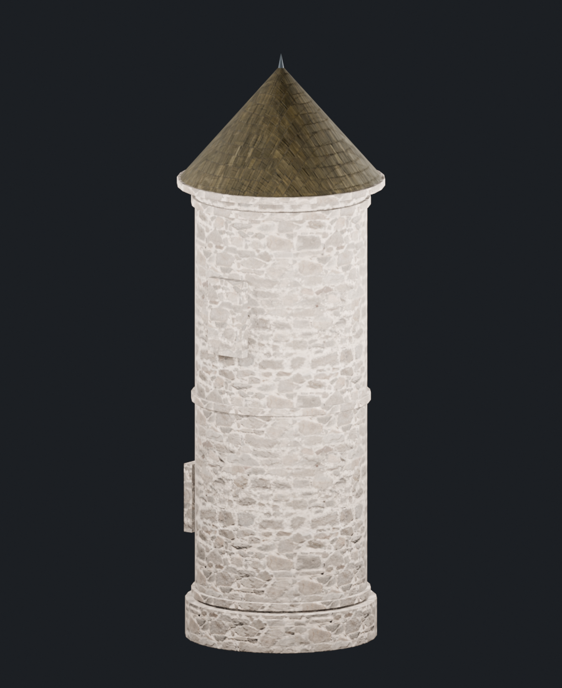
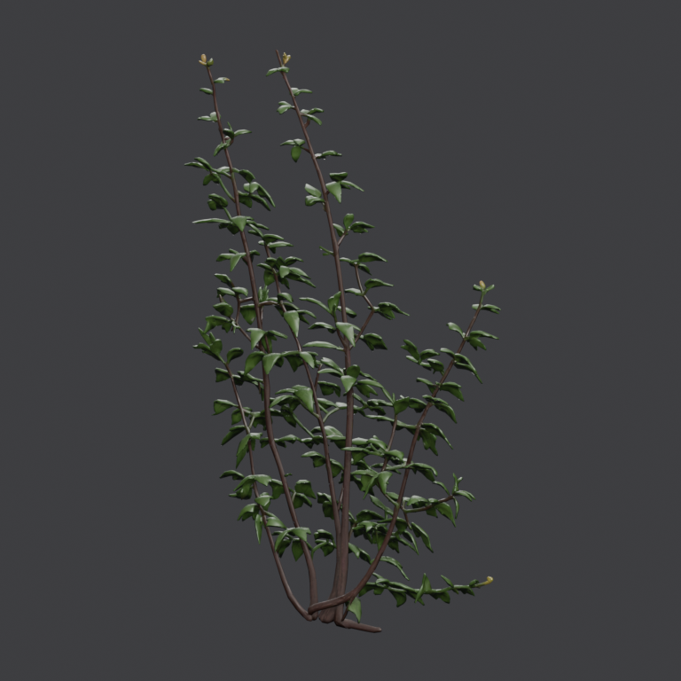
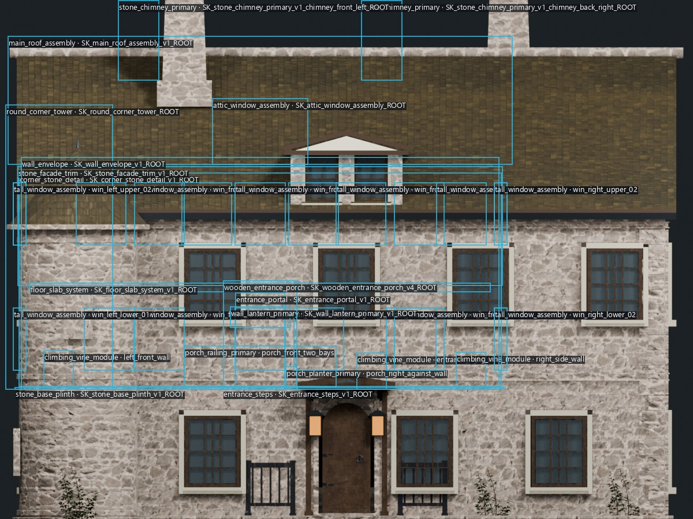
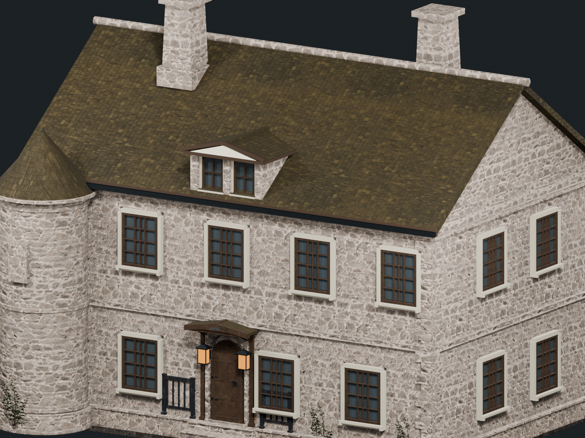

# Scene Kit

Language: [中文](README.md) | English

**An auditable, component-based and parametric architectural workflow for Blender.**

Scene Kit is an architectural 3D workflow skill, not a fixed model pack and not a one-shot modeling prompt. It organizes concept development, quantity auditing, decomposition, generation, assembly, and finishing into a reusable, parametric, version-audited process.

> **Input:** architectural concepts, original multi-view references, dimensional and style constraints.
>
> **Output:** decomposable, reusable, reproducible, and auditable Blender components and whole-building assemblies.

Scene Kit can work with Blender, parametric generators, and optional AI 3D providers. Those models are execution tools. The long-term efficiency and quality come from component contracts, parameter propagation, asset reuse, and evidence-based gates.



<sub>[Chinese full-size diagram](assets/scene-kit-workflow-zh.png) · [English full-size diagram](assets/scene-kit-workflow-en.png)</sub>

## 1. What Scene Kit Is

The most common architectural-production problems are not simply "one component is not attractive enough." They are:

- The references are understood, but chimneys, brackets, louvers, or roof attachments are missed during decomposition.
- A facade width, window type, or roof parameter changes, but related components and the assembly do not follow.
- Every new building requires regenerating the same windows, doors, railings, and moldings.
- Something looks correct from the front, but later turns out to have no side thickness, rear enclosure, or support.
- Final screenshots and QA no longer belong to the current model, yet old evidence continues to be used.

Scene Kit turns these problems into executable data and audits:

- The reference model establishes spatial context, but remains one baseline inside the process.
- Every component has a contract for interfaces, parameters, materials, source output, and current QA.
- Parameter changes produce a new build fingerprint; old geometry, screenshots, and audits become invalid.
- Approved components can be reused across projects and accumulate into a real component library.
- Rework feeds back into the quantity inventory, contracts, component sources, and assembly.

## 2. Core Workflow



### 2.1 Concept and fixed reference

Freeze the design language, key dimensions, and canonical ten views first. The reference model then produces fixed views from one shared center, orthographic scale, and resolution to verify massing, depth, occlusion, and attachments. Original source views remain distinct and are never replaced by derived renders.

### 2.2 Quantities before geometry

Complete a three-level inventory of macro components, repeated modules, and attachment details before modeling. Windows and doors are counted by elevation and floor; main roofs, dormer roofs, tower caps, and porch roofs are counted separately; chimney shafts, caps, and metal flues have their own quantities.

### 2.3 Component contracts

Every component defines:

- `locked`: openings, interfaces, thickness, origin, orientation, and contact surfaces.
- `guided`: massing silhouette, roof and wall language, material tendency, and period style.
- `free`: ornaments, window patterns, foliage distribution, and other generator-controlled details.

The contract also records implementation route, editable parameters, output files, material bindings, and the current build fingerprint. A component becomes a traceable, replaceable, reusable asset instead of a disposable AI result.

### 2.4 Generation and assembly

Rule-based walls, slabs, windows, doors, railings, and steps favor Blender parameterization or existing assets. Organic sculptures and vegetation may use AI 3D. Components are normalized in scale, origin, and interface before assembly, then the standalone sources and assembly are compared for consistency.

### 2.5 Finishing and acceptance

Assembly is not delivery. Surfaces, normals, seams, intersections, supports, materials, texture projection, and construction logic must still be checked, followed by fresh renders of the current revision.

## 3. Why the Method Works

- **Parametric batch changes:** wall widths, floor heights, openings, window groups, roofs, and arrays are contract-driven and rebuild together.
- **Component reuse:** approved windows, moldings, chimneys, railings, roof systems, and vegetation can be recombined across buildings.
- **Traceable quality:** every conclusion is supported by quantity, geometry, material, mask, host-connection, or export evidence.
- **Controlled rework:** a defect maps to a specific component and revision instead of forcing a complete rebuild.
- **Stable iteration:** rule-based parts stay reusable while explicit free zones preserve design variation.

## 4. Quality Gates

| Common failure | How Scene Kit checks it |
|---|---|
| Incomplete component inventory | Three-level inventory of macro components, repeated modules, and attachment details |
| Quantity drift | Cross-check `quantity_audit`, parametric contracts, and live assembly instances |
| Front-only parts with no depth or mounting surface | Verify side walls, rear enclosure, volume, projection depth, and host contact |
| Dormer roof crosses the eave or misses the rear wall | Verify eave setback, rear-wall coverage, and real intersection with the main roof |
| Tower, window, railing, or ornament occlusion | Measure live component masks, projected overlap, and front-to-back depth |
| Close color but wrong surface identity | Validate material semantics, texture scale, normals, roughness, and projection separately |
| Standalone components disagree with the assembly | Compare bounds, object counts, triangles, origins, and material bindings |
| Stale screenshots or approvals | Bind revision, parameter hash, file hashes, and current QA together |

## 5. Enhanced Detail Recognition

The canonical ten views remain mandatory and continue to gate `analysis_ready`. If a local feature remains unclear, such as a roof joint, hidden rear face, window depth, railing connection, attachment, or repeated quantity, additional temporary close-up or oblique views may be rendered from the same normalized reference model.

These diagnostic views support identification and cross-checking. They do not replace or reorder the fixed ten views and do not need to be retained in the final project. Conclusions from a diagnostic view must still be verified against an existing canonical view or original source material.

Attachment-integrity requirements also remain in force: dormer components need real volume, side and rear enclosure, projection beyond the host, an inboard roof edge, and a verified connection to the main roof.

## 6. Case Study: Fairy-Tale Castle 01

The case below shows how the method applies to a real building. Its specific style, component counts, and roof forms are examples, not fixed Scene Kit rules.

The main facade is **11.4 m** wide and the assembly contains **40 component instances**, including 21 main windows, three climbing-vine modules, and one entrance planter. Per-instance front silhouettes cover all 40 instances, with no tower/window or unexplained cross-component overlaps.



### 6.1 Starting from the original ten views



These ten views are the user-supplied source input, not renders regenerated from the reference model. They establish the reference model, component boundaries and counts, material checks, and occlusion review. Derived views remain process-audit evidence only.

### 6.2 Roof-to-wall rework

The paired attic windows belong to a real enclosed dormer volume. Both cheeks use **triangular sections** that taper along the main roof pitch, and the floor stops at the roof intersection. The small roof front is set back **0.09 m** from the main eave, while its rear edge remains embedded in the main roof.

### 6.3 Component examples

The round tower and climbing vines are not inseparable parts of the final model. Each is a component asset with its own source, parametric contract, material bindings, and QA. Approved components are assembled into the building and can be reused in later projects through the same interfaces.

| Round corner tower | Climbing vine |
|:---:|:---:|
|  |  |
| Independent tower body, cap, and windows | Reusable instantiated vine module |

### 6.4 Components and front-view occlusion



The 21 main windows are audited by elevation and floor: three on the ground-floor front elevation with the door axis skipped, and four on the upper floor including the centered door-axis window. The tower, window groups, wall lantern, vines, and chimneys pass the live-instance and silhouette checks for the current assembly.

### 6.5 Color and surface

The roof uses a dark warm-charcoal flat slate and the Color, NormalGL, and Roughness maps from Poly Haven `roof_slates_02`. The current render has a mean green-channel error of **1.1** and a hue error of **0.0139** against the recorded reference samples.

### 6.6 Case Deliverable Scope

The case delivers the whole-building Blender source, whole-building GLB, a 17-component library index, the current assembly report, front-view component audit, key quantity audit, quantity gate result, host-connection and rear-volume audit, original ten-view input audit, and facade opening contract.

## 7. Install and Quick Start

Copy the `scene-kit/` folder into the skill directory supported by your host.

```powershell
Copy-Item .\scene-kit "$HOME\.codex\skills\scene-kit" -Recurse
```

```bash
python scene-kit/scripts/scene_kit.py init ./my-scene --name "Garden Villa"
python scene-kit/scripts/scene_kit.py prompts ./my-scene
python scene-kit/scripts/scene_kit.py validate ./my-scene
```

See [INSTALL.md](INSTALL.md) for installation, commands, and migration guidance. The main skill entry point is [scene-kit/SKILL.md](scene-kit/SKILL.md).

## 8. Repository Layout

```text
README.md / README.en.md   unified GitHub entry points
INSTALL.md                 installation and command reference
scene-kit/                 Scene Kit skill
scene-kit.standalone.md    single-file rule variant
assembly/                  case-study Blender and GLB files
components/                case component index and QA; standalone component binaries remain in the full project workspace
assets/preview/            case references, QA, and current renders
internal/                  current quantity, opening, host, and acceptance audits
```

## 9. Limitations and License

The example is not a final production-grade asset. Some railing connections, post spacing, local stonework, and molding continuity remain simplified, and extreme close-up surface detail can be refined further. The README reflects the current assembly state.

- Runtime: Python 3.10+, Blender, and an optional AI 3D provider
- Supported hosts: Codex, Claude Code, Trae, and similar skill hosts
- This repository does not currently grant a license. Add an appropriate license before public redistribution.

## 10. Final Result

<p align="center">
  
</p>
