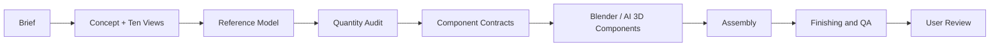

# Scene Kit

Language: [中文](README.md) | English

**An auditable, component-based and parametric architectural workflow for Blender.**

Scene Kit's core advantage is not merely producing a reference model. It turns the complete process—from concept, quantity census, decomposition, generation, and assembly through finishing—into a reusable, parametric, and version-audited workflow. The reference model provides the spatial baseline; the durable value comes from component contracts, parametric reuse, and evidence-based quality gates.


Current release: **Scene Kit 7.22**. This repository combines the skill workflow with the final result of its real-world case study, **Fairy-Tale Castle 01**.

## Why Scene Kit

- **Understand the whole building before decomposition:** create a `reference_only` 3D reference first, then use a fixed ten-view rig to verify massing, depth, occlusion, and attachments.
- **Quantities before geometry:** count windows, doors, roofs, chimneys, flues, and repeated attachments before modeling so omissions and duplicates are caught early.
- **A contract for every component:** interfaces, dimensions, origins, materials, parameters, build fingerprints, and QA are stored in structured contracts. Any parameter change invalidates stale results.
- **Evidence-driven audits:** color, material semantics, texture projection, silhouette masks, host connections, and construction logic are verified separately rather than inferred from one hero image.
- **Feedback must propagate backward:** missing parts, quantity errors, intersections, material mistakes, and seam problems update the reference inventory, contracts, component sources, and final assembly together.

## Starting from the reference ten views


The ten views are the source input for this case. They establish the reference model, component boundaries and counts, material validation, and occlusion checks. Fixed views rendered from the reference model are process-audit evidence, not substitutes for the user-supplied source material.

## Case Study: Fairy-Tale Castle 01

The case is at `FINISHING`, revision 11. The main facade is **11.4 m** wide and the assembly contains **40 component instances**, including 21 main windows, three climbing-vine modules, and one entrance planter. Per-instance front silhouettes cover all 40 instances, with no tower/window or unexplained cross-component overlaps.


### Attic and roof junction

The paired attic windows belong to a real enclosed dormer volume rather than sitting on the roof as window planes. Both cheeks use **triangular sections** that taper along the main roof pitch, and the floor stops at the roof intersection. The small roof front is set back **0.09 m** from the main eave, while its rear edge remains embedded in the main roof and continues to cover the full body depth.


### Color and surface

The roof uses a dark warm-charcoal flat slate and the Color, NormalGL, and Roughness maps from Poly Haven `roof_slates_02`. The current render has a mean green-channel error of **1.1** and a hue error of **0.0139** against the recorded reference samples, both within project tolerances.

### Components and front-view occlusion


The 21 main windows are audited by elevation and floor: three on the ground-floor front elevation with the door axis skipped, and four on the upper floor including the centered door-axis window. The tower, window groups, wall lantern, vines, and chimneys all pass the live-instance and silhouette checks for revision 11.

## Workflow



1. **BRIEF / CONCEPTS:** define dimensions and delivery goals, then establish a consistent ten-view design language.
2. **COMPONENTS:** create and validate the reference model, build the camera rig, count features, and complete multi-view decomposition.
3. **REFERENCES / GENERATION:** define silhouettes, interfaces, materials, and generation routes for every component. Prefer parameterization or reuse for rule-based parts.
4. **ASSEMBLY:** normalize scale, origins, orientation, and contact surfaces, then verify that standalone sources and the assembly agree.
5. **FINISHING:** repair surfaces, normals, seams, intersections, supports, and materials, then rerun every audit for the current revision.
6. **REVIEW / COMPLETE:** after user approval, record the accepted revision, export deliverables, and close the project.

## Quality Gates

| Common failure | How Scene Kit checks it |
|---|---|
| Incomplete component inventory | Three-level inventory of macro components, repeated modules, and attachment details, linked to real parts |
| Quantity drift | Cross-check `quantity_audit`, parametric contracts, and live assembly instances |
| Front-only parts with no depth or mounting surface | Verify side walls, back enclosure, volume, projection depth, and host contact |
| Dormer roof crosses the eave or misses the rear wall | Verify eave setback, rear-wall coverage, and real intersection with the main roof |
| Tower, window, railing, or ornament occlusion | Measure live component masks, projected overlap, and front-to-back depth |
| Close color but wrong surface identity | Validate material semantics, texture scale, normals, roughness, and projection separately |
| Standalone components disagree with the assembly | Compare bounds, object counts, triangles, origins, and material bindings |
| Stale screenshots or approvals | Bind revision, parameter hash, file hashes, and current QA together |

## Scene Kit 7.22

The canonical ten views remain mandatory and continue to gate `analysis_ready`. If a local feature remains unclear, such as a roof joint, hidden rear face, window depth, railing connection, attachment, or repeated quantity, additional temporary close-up or oblique views may be rendered from the same normalized reference model.

These diagnostic views support identification and cross-checking. They do not replace or reorder the fixed ten views and do not need to be retained in the final project. Any conclusion from a diagnostic view must still be verified against an existing canonical view or the original source material.

The 7.21 attachment-integrity requirements remain in force: dormer components need real volume, side and rear enclosure, projection beyond the host, an inboard roof edge, and a verified connection to the main roof.

## Case Deliverables

- [Whole-building Blender source](assembly/castle_assembly.blend)
- [Whole-building GLB](assembly/fairy_tale_castle_01.glb)
- [Component library index](components/README.md)
- [Current assembly report](assets/preview/assembly/assembly_report.json)
- [Front-view component audit](internal/assembly_front_visibility_audit.json)
- [Key quantity audit](internal/quantity_audit_v11.json)
- [Quantity gate result](internal/quantity_census_audit.json)
- [Host connection and rear-volume audit](internal/attachment_integrity_audit_v11.json)
- [Original ten-view input audit](internal/source_ten_view_input_audit_v11.json)
- [Facade opening contract](internal/wall_openings_v2.json)

## Install and Quick Start

Copy the `scene-kit/` folder into the skill directory supported by your host.

```powershell
Copy-Item .\scene-kit "$HOME\.codex\skills\scene-kit" -Recurse
```

```bash
python scene-kit/scripts/scene_kit.py init ./my-scene --name "Garden Villa"
python scene-kit/scripts/scene_kit.py prompts ./my-scene
python scene-kit/scripts/scene_kit.py validate ./my-scene
```

See [INSTALL.md](INSTALL.md) for installation, commands, and migration guidance. The main skill entry point is [scene-kit/SKILL.md](scene-kit/SKILL.md).

## Repository Layout

```text
README.md / README.en.md   unified GitHub entry points
INSTALL.md                 installation and command reference
scene-kit/                 final Scene Kit 7.22 skill
scene-kit.standalone.md    single-file rule variant
assembly/                  case-study Blender and GLB files
components/                case-study component index
assets/preview/            reference images, QA, and current renders
internal/                  current quantity, opening, host, and acceptance audits
```

## Current Limitations

The example is not a final production-grade asset. Some railing connections, post spacing, local stonework, and molding continuity remain simplified, and extreme close-up surface detail can be refined further. The README reflects the actual state of revision 11 and does not describe unfinished details as complete.

## Requirements and License

- Python 3.10+
- Blender
- An optional AI 3D provider
- A compatible skill host such as Codex, Claude Code, or Trae

This repository does not currently grant a license. Add an appropriate license before public redistribution.
