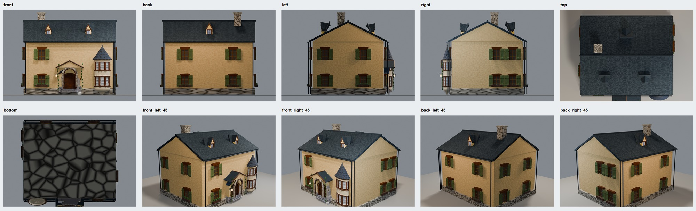
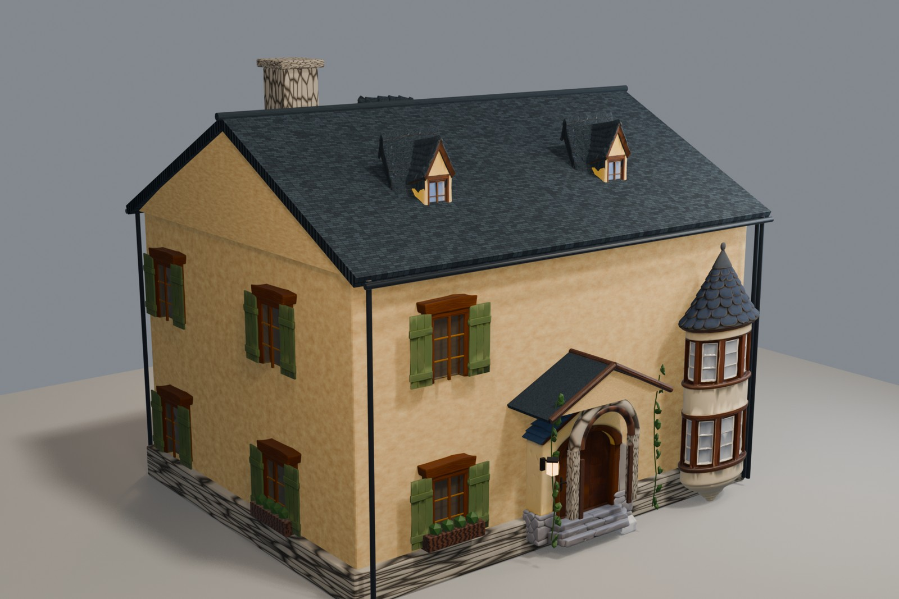
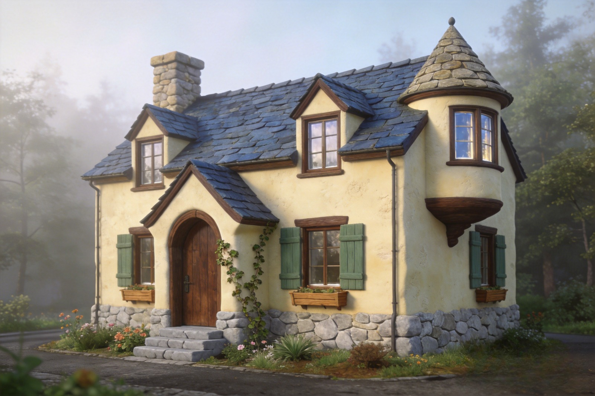

# Scene Kit

[](assets/scene-kit-workflow-bilingual.png)

[Chinese full-size](assets/scene-kit-workflow-zh.png) · [English full-size](assets/scene-kit-workflow-en.png)

Scene Kit is a concept-first Blender workflow that turns architectural references into modular, reusable, and construction-logically coherent 3D buildings through multi-view audits, AI-assisted component generation, and quality-first surface refinement.

## Example: from rough blockout to refined result

> The first two images are intentionally **unrefined work-in-progress** views. They still contain visible problems in surfaces, roof connections, supports, and assembly. That is expected at this stage and is exactly why Scene Kit keeps refining instead of treating the first assembled model as final.

### 1. Ten-view inspection



Early multi-view render used to check the building from all required directions. The roughness and connection problems are visible, so this version is **not ready for delivery**.

### 2. Rough assembly



The first assembled blockout. Surface quality and several eave, roof, and support relationships still need repair. This is intentionally shown as a process state.

### 3. Refined result



Refined-result illustration showing the intended finish: coherent surfaces, believable roof and eave connections, controlled materials, and a visually complete architectural presentation. A production model should pass the final `FINISHING` checks before reaching this level.

## What it does

- Explores distinct architectural directions before modeling.
- Checks decomposed components against the original multi-view references.
- Generates one reusable 3D asset at a time.
- Assembles components in Blender with controlled dimensions and interfaces.
- Refines surfaces, joints, and construction logic before final review.
- Reuses approved assets through a cross-project model library.

## Workflow

1. **Define and explore**  
   Set the key dimensions and views, then develop consistent concept images.

2. **Design and audit**  
   Freeze the design language, decompose the building, and verify that every part is complete and can connect.

3. **Generate and assemble**  
   Generate isolated components, compare them with references, normalize them, and assemble the building.

4. **Finish and review**  
   Refine mesh surfaces, materials, supports, and seams. Repair visible structural problems and render the current revision before approval.

Quality comes first: visual match, surface quality, and construction logic outrank production render time and token consumption.

## Install

Copy the `scene-kit` folder into the skill directory used by your host.

### Codex on Windows

```powershell
Copy-Item .\scene-kit "$HOME\.codex\skills\scene-kit" -Recurse
```

### macOS or Linux

```bash
cp -R ./scene-kit ~/.codex/skills/scene-kit
```

Claude Code and project-level skill directories work the same way. `scene-kit.standalone.md` is available for hosts that can read only one instruction file.

## Quick start

```bash
python scene-kit/scripts/scene_kit.py init ./my-scene --name "Garden Villa"
python scene-kit/scripts/scene_kit.py prompts ./my-scene
python scene-kit/scripts/scene_kit.py validate ./my-scene
python scene-kit/scripts/scene_kit.py advance ./my-scene
```

Use `--confirmed-by-user` only after the user explicitly approves the stage decision.

Return to an earlier stage for rework:

```bash
python scene-kit/scripts/scene_kit.py reopen ./my-scene FINISHING \
  --reason "Repair component connections" --confirmed-by-user
```

## Requirements

- Python 3.10 or newer
- Blender
- An AI 3D provider such as Tripo, Hunyuan3D, Hyper3D, or Meshy
- A compatible skill host such as Codex, Claude Code, or Trae

API keys, credits, generated assets, and Blender scenes are not included.

## Repository contents

```text
scene-kit/
  SKILL.md
  agents/
  references/
  scripts/
```

The full instructions are in `scene-kit/SKILL.md`. Detailed stage, data, and repair guidance is in `scene-kit/references/`.

## Validate

```bash
python scene-kit/scripts/test_scene_kit.py
```

## License

This repository does not currently grant a license. Add an appropriate license before public distribution.
