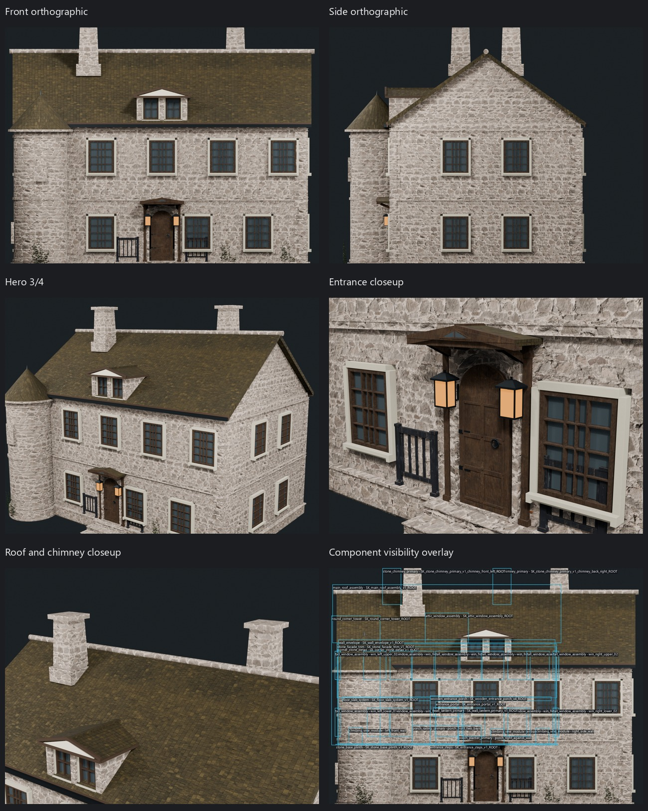

# 童话城堡 01

语言：[English](README.en.md) | 中文

当前阶段：`FINISHING`，当前版本：`revision 11`。

本案例使用 **DeepSeek V4.1 Flash** 完成。不同模型的规划、视觉理解、几何推理和修复能力不同，其他模型可能获得更好的效果。

## 当前结果



建筑主体已加宽到 **11.4 m**。关键数量已按“立面 × 楼层”单独审计：正面一层为 **3 扇窗**并跳过门轴，二层为 **4 扇窗**且门轴上方有窗。左侧圆塔使用加宽后恢复的墙体接触，同时保留与全部窗组的净距。


当前装配共 40 个组件实例，其中主窗 21、攀援藤蔓 3、入口盆栽 1。逐实例正视图遮罩已覆盖全部 40 个实例；圆塔与窗、壁灯与窗框均无未解释的重叠。


## 阁楼体量、屋顶与正面植物

阁楼双窗是小房体的前脸，不是孤立窗户。窗后是带前墙、底板和左右侧墙的封闭老虎窗体量。两侧墙改为沿主屋面坡向收束的 **三角形截面**，底板止于屋面交线；小屋顶前沿比主檐退后 **0.09 m**，后缘继续埋入主屋面，避免侧视出现裸露的竖直墙体断面。

三组藤蔓已重新布置到左前圆塔、一层窗间墙墩和右侧前墙墩，全部位于正立面并具有可见轮廓。两座石烟囱保留石柱和石帽，顶部黑色金属烟管数量为 0。

## 颜色与表面

屋面保持已经确认的暗暖炭色，并使用 Poly Haven `roof_slates_02` 的扁平石板瓦 Color、NormalGL 与 Roughness。当前渲染与参考采样中，屋顶绿色通道平均误差为 1.1、色相误差为 0.0139，处于已记录容差内。


## 参考依据


上图为用户提供的原始素材十视图，不是由参考模型重新渲染的派生图。它以项目内 `assets/raw/` 的原始视图副本制作，可直接追溯问题输入与最终装配之间的差异；由参考模型派生的固定视角只作为过程审计资料保存在 `assets/preview/reference/`。

原始输入与生成输入裁片只保存在 `assets/raw/`；参考视图、组件 QA、整栋渲染和精简过程对照只保存在 `assets/preview/`。同一张图通过相对路径被 README 和审计记录重复引用，不复制文件。

## Skill 带来的优势

- **参数化批量修改**：墙宽、层高、洞口、窗格、屋顶坡度和构件阵列都由合同参数控制。调整建筑宽度或统一窗型时，可以批量重建相关组件和审计，而不是逐件重新生成模型。
- **组件资产复用**：门窗、栏杆、线脚、烟囱、植物等通过统一接口和材质进入组件库。后续建筑可以重新组合这些资产，在保持统一风格的同时形成不同立面、体量和布局。
- **减少重复 AI 3D 生成**：规则结构、门窗和重复附件优先使用参数化或复用资产；AI 3D 主要留给难以参数化的有机或雕刻单体，因此不必为每一栋建筑重新生成全部三维模型。

## 当前不足

当前模型仍不是最终生产级资产：部分栏杆的连接与细部节奏仍偏简化，局部石砌和线脚的连续关系、极近景下的表面细节还可以继续精修。README 展示的是当前 revision 的真实状态，不把尚未完成的构造细节描述成已完成。

## 项目结构

```text
components/   17 件最终组件，每件一份 .blend 与一份 .glb
assembly/     整栋 .blend、交付 .glb 和当前五视图
reference/    三维参考模型及结构化记录
assets/
  raw/        原始概念视图与生成输入
  preview/    参考、组件 QA、整栋 QA 与精选过程图
concepts/     概念提示词和审阅记录
internal/     尺寸合同、参数合同、审计和迁移记录
textures/     共享 PBR 贴图
scripts/      当前版本可复现生成与审计脚本
```

被加宽影响的 7 个组件源文件已从已验证的整栋几何重建。阁楼窗组件已升级到 revision 7，整栋装配、README 与 GLB 均属于 revision 11。

## 交付文件

- [整栋 Blender 源文件](assembly/castle_assembly.blend)
- [整栋 GLB](assembly/fairy_tale_castle_01.glb)
- [组件库索引](components/README.md)
- [当前装配报告](assets/preview/assembly/assembly_report.json)
- [正视图组件审计](internal/assembly_front_visibility_audit.json)
- [关键数量审计](internal/quantity_audit_v11.json)
- [数量门禁结果](internal/quantity_census_audit.json)
- [宿主连接与背面体量审计](internal/attachment_integrity_audit_v11.json)
- [原始十视图输入审计](internal/source_ten_view_input_audit_v11.json)
- [立面洞口合同](internal/wall_openings_v2.json)
- [目录整理记录](internal/media_structure_v11.json)

## 下一步

当前 revision 已通过数量矩阵、宿主连接、场景、参数合同、组件源、导出导入、正视图遮挡和材质门禁。下一步进入用户 `REVIEW`；用户确认后再执行 `COMPLETE`。
