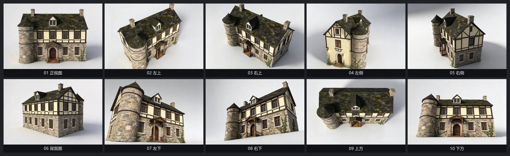
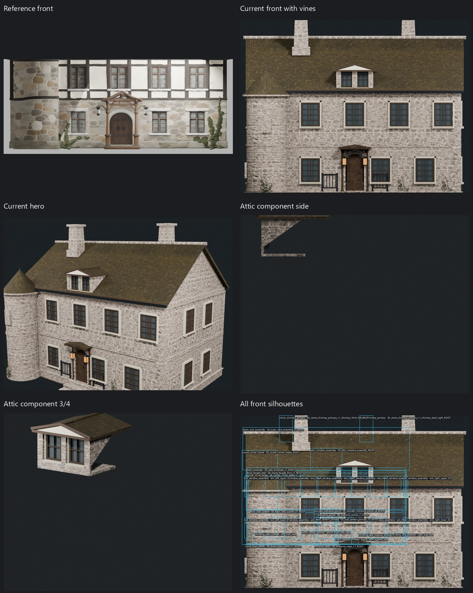
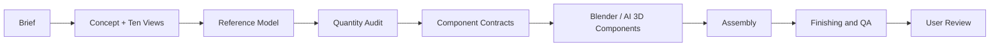

# Scene Kit

语言：[English](README.en.md) | 中文

**以参考模型优先的 Blender 建筑组件化流程。**

Scene Kit 不把“一次生成完”当成成品，而是把建筑拆成可验证、可重建、可复用、可持续精修的组件，并用数量、轮廓、材质、宿主连接和构造逻辑门禁逐轮收敛。


当前发布版本：**Scene Kit 7.22**。下方首页同时展示 skill 工作流和实际案例 **童话城堡 01** 的最终结果。

## 为什么使用 Scene Kit

- **先理解整栋，再拆组件**：先生成 `reference_only` 整栋三维参考，再用固定十视图确认体量、深度、遮挡和附着关系。
- **数量先于几何**：先记录窗、门、屋顶、烟囱、烟管和重复附件的数量，再开始建模，避免装配完成后才发现遗漏或重复。
- **每件组件都有合同**：接口、尺寸、原点、材质、参数、构建指纹和 QA 都写入结构化合同，参数变化后旧结果自动失效。
- **审计看证据**：颜色、材质、贴图投影、轮廓遮罩、宿主连接和构造逻辑分别检查，不依赖单张 hero 图或模型自述。
- **返工必须回灌**：用户指出的漏项、数量、干涉、材质和接缝问题，要同步修正参考清单、合同、组件源和整栋装配。

## 从参考十视图开始



十视图是这个案例的原始输入，用于建立整栋参考、识别组件边界与数量、核对材质和遮挡。由参考模型派生的固定十视图只作为过程审计资料，不用来冒充用户原始素材。

## 案例：童话城堡 01

当前阶段为 `FINISHING`，版本为 `revision 11`。建筑主体宽 **11.4 m**，整栋包含 **40 个组件实例**，其中主窗 21、攀援藤蔓 3、入口盆栽 1。正视图逐实例遮罩覆盖全部 40 个实例，没有塔楼/窗或未解释的跨组件重叠。


### 阁楼与屋顶连接

阁楼双窗属于一个真实的封闭小房体，不是贴在屋面上的窗片。两侧墙使用沿主屋面坡度收束的**三角形截面**，底板止于屋面交线；小屋顶前沿比主檐退后 **0.09 m**，后缘埋入主屋面并继续覆盖房体深度。



### 颜色与表面

屋面采用暗暖炭色扁平石板瓦，并使用 Poly Haven `roof_slates_02` 的 Color、NormalGL 与 Roughness。当前渲染与参考采样的绿色通道平均误差为 **1.1**、色相误差为 **0.0139**，处于项目记录容差内。

### 组件与正视遮挡


21 扇主窗按照“立面 × 楼层”计数审计：正面一层为 3 扇并跳过门轴，二层为 4 扇且门轴上方有窗。圆塔、窗组、壁灯、藤蔓和烟囱均通过当前 rev 11 的实时实例与轮廓检查。

## 工作流



1. **BRIEF / CONCEPTS**：明确尺寸与交付目标，建立一致的十视图设计语言。
2. **COMPONENTS**：生成整栋参考，验证网格与相机轨道，清点构件并完成多视图拆件。
3. **REFERENCES / GENERATION**：为每件组件建立轮廓、接口、材质和生成路线；规则构件优先参数化或复用。
4. **ASSEMBLY**：统一比例、原点、朝向和接触面，核对组件源与整栋装配一致。
5. **FINISHING**：修复面片、法线、接缝、穿插、支撑和材质问题，运行当前 revision 的全部审计。
6. **REVIEW / COMPLETE**：用户确认后更新验收版本，完成导出和项目收尾。

## 质量门禁

| 常见问题 | Scene Kit 的检查方式 |
|---|---|
| 构件清单不完整 | 宏构件、重复模块、附着细节三层盘点，并链接真实组件 |
| 数量漂移 | `quantity_audit` 分项合计、参数合同和实时装配实例联合核对 |
| 只有正面，没有厚度或安装面 | 检查侧墙、背板、体积、前凸深度和宿主接触 |
| 屋顶窗越檐或盖不到后墙 | 检查主檐退让、后墙覆盖和主屋面实际相交 |
| 塔楼、窗、栏杆或装饰互相遮挡 | 实时组件遮罩、投影重叠和前后深度审计 |
| 颜色接近但材质身份错误 | 分别检查材质语义、纹理尺度、法线、粗糙度和投影 |
| 独立组件与整栋尺寸不一致 | 比较包围盒、对象数、三角面、原点和材质绑定 |
| 仍在使用旧截图或旧审批 | 绑定 revision、参数指纹、文件哈希和当前 QA |

## Scene Kit 7.22

固定十视图仍是必查主视图和 `analysis_ready` 门禁。若某个局部特征仍不明确，例如屋顶接缝、被遮挡背面、门窗深度、栏杆连接、附着结构或重复数量，可以从同一归一化参考模型临时补拍近景或斜向诊断视角。

这些补充视角只用于识别和交叉确认，不替换或重排固定十视图，也不要求保存到最终项目。任何由补充视角得到的结论仍需与既有十视图或原始素材互相验证。

7.21 的附着结构门禁继续保留：屋顶窗和老虎窗必须具有真实体积、侧向与背面结构、前凸深度、主檐内退和主屋面连接。

## 案例交付

- [整栋 Blender 源文件](assembly/castle_assembly.blend)
- [整栋 GLB](assembly/fairy_tale_castle_01.glb)
- [组件库索引](components/README.md)
- [当前装配报告](assets/preview/assembly/assembly_report.json)
- [正视图组件审计](internal/assembly_front_visibility_audit.json)
- [关键数量审计](internal/quantity_audit_v11.json)
- [数量门禁结果](internal/quantity_census_audit.json)
- [宿主连接与背面体量审计](internal/attachment_integrity_audit_v11.json)
- [原始十视图输入审计](internal/source_ten_view_input_audit_v11.json)
- [立面洞口合同](internal/wall_openings_v2.json)

## 安装与快速开始

把 `scene-kit/` 放入宿主支持的 skills 目录。

```powershell
Copy-Item .\scene-kit "$HOME\.codex\skills\scene-kit" -Recurse
```

```bash
python scene-kit/scripts/scene_kit.py init ./my-scene --name "Garden Villa"
python scene-kit/scripts/scene_kit.py prompts ./my-scene
python scene-kit/scripts/scene_kit.py validate ./my-scene
```

完整安装、命令和迁移说明见 [INSTALL.md](INSTALL.md)，skill 主入口见 [scene-kit/SKILL.md](scene-kit/SKILL.md)。

## 仓库结构

```text
README.md / README.en.md   合并后的 GitHub 首页
INSTALL.md                 安装与命令说明
scene-kit/                 最终版 7.22 skill
scene-kit.standalone.md    单文件规则版
assembly/                  案例整栋 Blender 与 GLB
components/                案例组件索引
assets/preview/            案例参考图、QA 与当前渲染
internal/                  当前版本数量、洞口、宿主与验收审计
```

## 当前不足

示例模型仍不是最终生产级资产。部分栏杆连接、立柱节奏、局部石砌和线脚连续性仍偏简化，极近景表面细节还可继续精修。README 展示的是 revision 11 的真实状态，不把未完成细节描述成已完成。

## 环境与许可

- Python 3.10+
- Blender
- 可选的 AI 3D Provider
- 支持 skills 的宿主：Codex、Claude Code、Trae 等

当前仓库尚未声明开源许可证。公开再分发前应补充合适的 License。
