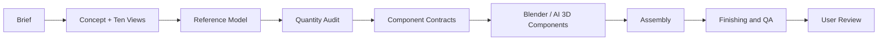
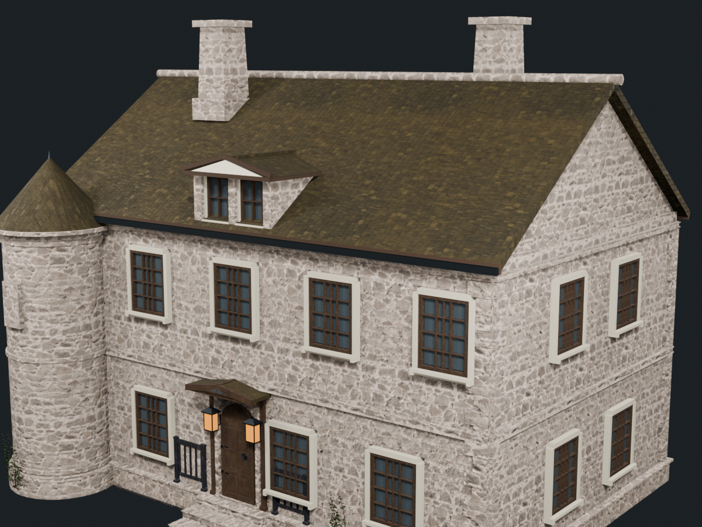

# Scene Kit

语言：[English](README.en.md) | 中文

**面向 Blender 的可审计建筑组件化与参数化工作流。**

Scene Kit 是一个建筑 3D 工作流 skill，不是一组固定模型，也不是“一次生成完就结束”的建模提示词。它把建筑从概念、数量清点、拆分、生成、装配到精修组织成一套可复用、可参数化、可逐版本审计的流程。

> **输入**：建筑概念图、原始多视图、尺寸与风格约束。
>
> **输出**：可拆解、可复用、可重建、可审计的 Blender 建筑组件与整栋装配。

Scene Kit 可以配合 Blender、参数化生成器和可选的 AI 3D 服务使用。具体模型只是执行工具；真正决定长期效率和质量的是组件合同、参数传播、资产复用和证据化门禁。


<sub>[中文全尺寸流程图](assets/scene-kit-workflow-zh.png) · [English full-size diagram](assets/scene-kit-workflow-en.png)</sub>

## 1. Scene Kit 是什么

建筑项目最常见的问题不是“某一个构件不够漂亮”，而是：

- 参考图看懂了，但拆件时漏掉烟囱、托架、百叶或屋顶附件。
- 改了墙宽、窗型或屋顶参数，相关组件和整栋装配没有同步更新。
- 每次做新建筑都要重新生成整套窗、门、栏杆和线脚。
- 正面看起来成立，侧面才发现构件没有厚度、背面或支撑。
- 最终截图和当前模型不属于同一版本，旧 QA 被继续沿用。

Scene Kit 的做法是把这些问题变成可执行的数据和审计：

- 参考模型用于理解空间关系，但只是流程中的一个基准。
- 每件组件都有独立合同，记录接口、参数、材质、源文件和当前 QA。
- 参数变化会生成新的构建指纹，旧几何、旧截图和旧审计立即失效。
- 已完成组件可以跨项目复用，逐步积累真正的组件库。
- 每轮返工都会回灌到数量表、合同、组件源和整栋装配。

## 2. 核心工作流



### 2.1 概念与固定参考

先固定设计语言、关键尺寸和标准十视图。再由整栋参考模型派生同一中心、同一正交尺度和同一分辨率的固定视角，用于判断体量、深度、遮挡和附着关系。原始素材始终保留，不能被派生渲染冒充。

### 2.2 数量先于几何

在建模前完成宏构件、重复模块和附着细节三层清单。窗门按立面和楼层计数，主屋顶、小屋顶、塔帽和门廊屋顶分开统计，烟囱石柱、石帽和金属烟管分别记录。数量未确认时不进入批量建模。

### 2.3 组件合同

每件组件至少定义：

- `locked`：洞口、接口、厚度、原点、朝向和接触面。
- `guided`：体量轮廓、屋顶与墙面语言、材料倾向和年代风格。
- `free`：雕花、窗格、叶簇分布等可由生成器发挥的部分。

合同同时记录生成方式、可编辑参数、输出文件、材质绑定和当前构建指纹。组件不再是一次性的 AI 输出，而是可追溯、可替换、可复用的资产。

### 2.4 生成与装配

规则墙段、楼板、门窗、栏杆和台阶优先使用 Blender 参数化或已有组件；有机雕刻和植物再考虑 AI 3D。所有组件统一比例、原点和接口后进入装配，并核对独立组件源与整栋模型是否一致。

### 2.5 精修与验收

装配完成不等于交付。必须继续检查面片、法线、接缝、穿插、支撑、材质、贴图投影和构造逻辑，并重新渲染当前 revision 的整栋图、关键近景和参考对照。

## 3. 为什么这套方法有效

- **参数化批量修改**：墙宽、层高、洞口、窗组、屋顶和阵列由合同参数控制，调整一次后批量重建并重跑审计。
- **组件资产复用**：通过验收的门窗、线脚、烟囱、栏杆、屋面与植物可以重新组合，减少重复建模和重复 AI 3D 生成。
- **质量可追溯**：每个结论都有数量、几何、材质、遮罩、宿主连接或导出记录支撑，不依赖“看起来差不多”。
- **返工成本可控**：问题定位到具体组件和 revision，不需要每次都推翻整栋模型。
- **适合持续迭代**：规则明确的部分稳定复用，造型不确定的部分保留在局部自由区。

## 4. 质量门禁

| 常见问题 | Scene Kit 的检查方式 |
|---|---|
| 构件盘点不完整 | 宏构件、重复模块、附着细节三层清单，并逐项链接真实组件 |
| 重复构件数量漂移 | `quantity_audit`、参数合同和实时装配实例联合核对 |
| 只有正面，没有厚度或安装面 | 检查侧墙、背板、体积、前凸深度和宿主接触 |
| 屋顶窗越檐或盖不到后墙 | 检查主檐退让、后墙覆盖和主屋面实际相交 |
| 塔楼、窗、栏杆或装饰互相遮挡 | 实时组件遮罩、投影重叠和前后深度审计 |
| 颜色接近但材质身份错误 | 分别检查材质语义、纹理尺度、法线、粗糙度和投影 |
| 独立组件与整栋尺寸不一致 | 比较包围盒、对象数、三角面、原点和材质绑定 |
| 仍在使用旧截图或旧审批 | 绑定 revision、参数指纹、文件哈希和当前 QA |

## 5. 细节识别增强

固定十视图仍是必查主视图和 `analysis_ready` 门禁。若某个局部特征仍不明确，例如屋顶接缝、被遮挡背面、门窗深度、栏杆连接、附着结构或重复数量，可以从同一归一化参考模型临时补拍近景或斜向诊断视角。

这些补充视角只用于识别和交叉确认，不替换或重排固定十视图，也不要求保存到最终项目。任何由补充视角得到的结论仍需与既有十视图或原始素材互相验证。

附着结构门禁同时要求：屋顶窗和老虎窗必须具有真实体积、侧向与背面结构、前凸深度、主檐内退和主屋面连接。

## 6. 案例：童话城堡 01

下面的案例用于展示上述方法如何落到一栋真实建筑，不把特定建筑风格、构件数量或屋顶形式变成 Scene Kit 的固定规则。

建筑主体宽 **11.4 m**，整栋包含 **40 个组件实例**，其中主窗 21、攀援藤蔓 3、入口盆栽 1。正视图逐实例遮罩覆盖全部 40 个实例，没有塔楼/窗或未解释的跨组件重叠。


### 6.1 从原始十视图开始


这里的十视图是用户提供的原始输入，不是由参考模型重新渲染的派生图。它用于建立整栋参考、识别组件边界和数量、核对材质与遮挡；派生视角只作为过程审计资料。

### 6.2 屋顶与墙体返工

阁楼双窗属于一个真实的封闭小房体，不是贴在屋面上的窗片。两侧墙使用沿主屋面坡度收束的**三角形截面**，底板止于屋面交线；小屋顶前沿比主檐退后 **0.09 m**，后缘埋入主屋面并继续覆盖房体深度。

### 6.3 组件与正视遮挡


21 扇主窗按照“立面 × 楼层”计数审计：正面一层为 3 扇并跳过门轴，二层为 4 扇且门轴上方有窗。圆塔、窗组、壁灯、藤蔓和烟囱均通过当前装配的实时实例与轮廓检查。

### 6.4 颜色与表面

屋面采用暗暖炭色扁平石板瓦，并使用 Poly Haven `roof_slates_02` 的 Color、NormalGL 与 Roughness。当前渲染与参考采样的绿色通道平均误差为 **1.1**、色相误差为 **0.0139**，处于项目记录容差内。

### 6.5 案例交付内容

本案例会交付整栋 Blender 源文件、整栋 GLB、17 件组件的库索引、当前装配报告、正视图组件审计、关键数量审计、数量门禁结果、宿主连接与背面体量审计、原始十视图输入审计，以及立面洞口合同。

## 7. 安装与快速开始

把 `scene-kit/` 放入宿主支持的 skills 目录。

```powershell
Copy-Item .\scene-kit "$HOME\.codex\skills\scene-kit" -Recurse
```

```bash
python scene-kit/scripts/scene_kit.py init ./my-scene --name "Garden Villa"
python scene-kit/scripts/scene_kit.py prompts ./my-scene
python scene-kit/scripts/scene_kit.py validate ./my-scene
```

完整安装、命令和迁移说明见 [INSTALL.md](INSTALL.md)，skill 主入口见 [scene-kit/SKILL.md](scene-kit/SKILL.md)。

## 8. 仓库结构

```text
README.md / README.en.md   合并后的 GitHub 首页
INSTALL.md                 安装与命令说明
scene-kit/                 Scene Kit skill
scene-kit.standalone.md    单文件规则版
assembly/                  案例整栋 Blender 与 GLB
components/                案例组件索引与 QA 入口；独立 .blend/.glb 留在完整项目目录
assets/preview/            案例参考图、QA 与当前渲染
internal/                  当前版本数量、洞口、宿主与验收审计
```

## 9. 当前不足与许可

示例模型仍不是最终生产级资产。部分栏杆连接、立柱节奏、局部石砌和线脚连续性仍偏简化，极近景表面细节还可继续精修。README 展示的是当前装配的真实状态，不把未完成细节描述成已完成。

- 运行环境：Python 3.10+、Blender、可选的 AI 3D Provider
- 支持宿主：Codex、Claude Code、Trae 等
- 当前仓库尚未声明开源许可证；公开再分发前应补充合适的 License。

## 10. 最终效果


