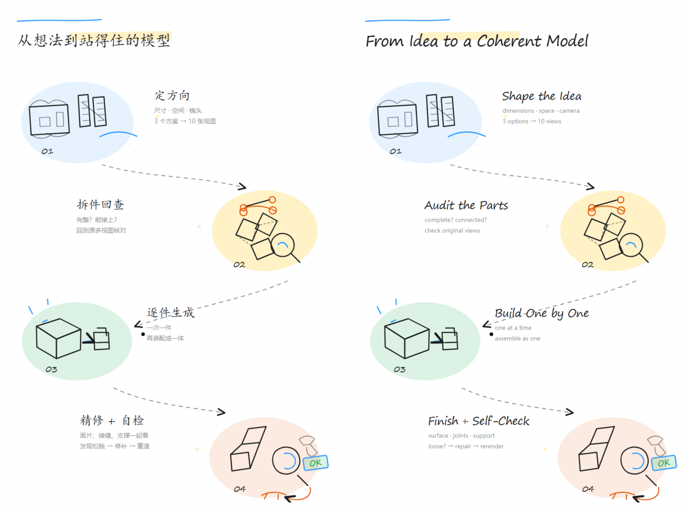
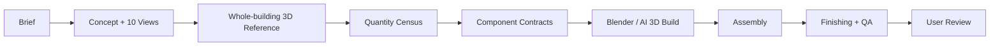
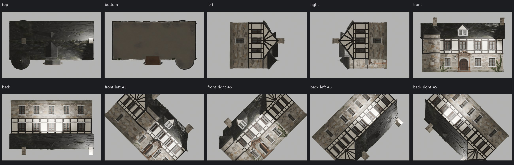
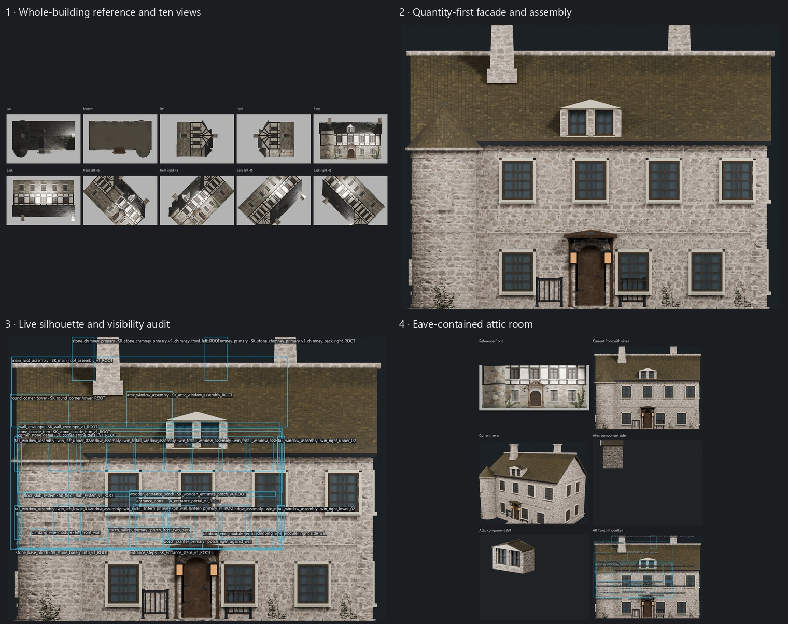

# Scene Kit

语言：[English](README.en.md) | 中文

**Reference-model-first architectural 3D workflow for Blender**

概念图 → 整栋三维参考 → 数量清点 → 参数化组件 → 多视图审计 → 装配精修

Scene Kit 不是“一次生成完就当成品”。它把参考建筑拆成可验证、可重建、可复用的组件，并通过数量、轮廓、材质、贴图和构造关系门禁，持续修复直到当前版本通过。



<sub>[中文流程图](assets/scene-kit-workflow-zh.png) · [English diagram](assets/scene-kit-workflow-en.png)</sub>

## 核心原则

- **参考模型优先**：先生成整栋 `reference_only` 三维模型，再用固定十视图定位组件、边界和深度。
- **数量先于几何**：先回答“有多少”，再决定“怎么做”。窗门按立面与楼层计数，屋顶、烟囱、烟管和装饰附件分别计数。
- **组件合同化**：每件资产都有锁定接口、可控参数、材质绑定、构建指纹和当前 revision 的 QA。
- **审计看证据**：颜色、材质、贴图、轮廓、遮挡、背面体积和宿主连接分别验收，截图不能替代审计记录。
- **返工必须回灌**：用户指出的漏项、数量错误、干涉和材质问题，要同步修正参考清单、合同、组件源和装配体。

## 工作流



1. **Reference**：冻结设计语言，建立整栋三维参考和固定十视图。
2. **Census**：清点宏构件、重复模块和附着细节，生成 `quantity_audit`。
3. **Contracts**：逐件定义 `locked / guided / free`、生成方式和质量门禁。
4. **Build**：规则构件优先 Blender，参数化或实例复用；有机单体再考虑提供方中立的 AI 3D。
5. **Assemble**：统一尺寸、原点、朝向和接触面，检查组件源与整栋装配一致。
6. **Finish**：检查网格、材质、贴图尺度、穿插、遮挡、支撑和收口，完成当前 revision 的验收图。

## 核心优势

### 1. 参数化批量修改

墙体、洞口、窗组、屋顶、栏杆、台阶和装饰阵列都由组件合同管理。修改建筑总宽、层高、窗型或屋顶参数后，可以批量重建相关组件，并统一重跑数量、接口、材质和多视图审计，避免对每个模型逐件手工返工。

### 2. 组件复用与自由组合

每件通过验收的资产都能作为独立组件复用。门窗、线脚、烟囱、栏杆、植物和屋面系统可以在不同建筑中重新组合，通过统一接口和材质规则保持同一种风格，同时形成不同的平面、体量与立面。

### 3. 减少重复 AI 3D 生成

规则结构和重复构件优先使用 Blender 参数化、实例和已有组件库。AI 3D 主要处理难以参数化的有机或雕刻单体。因此后续建筑不必每次都重新生成整栋 3D 模型，也能持续积累可复用资产。

## 从参考十视图开始



十视图用于建立整栋参考、识别组件数量与边界、核对材质和遮挡。它贯穿整个流程，最终模型会和同一组参考视图并排比较，而不是只在最后看一张 hero 图。

## 质量门禁

| 通用问题 | Scene Kit 的检查 |
|---|---|
| 构件盘点不完整 | 宏构件、重复模块、附着细节三层清单，并逐项追溯到组件 |
| 重复构件数量漂移 | `quantity_audit`、分项合计和实时实例数量联合核对 |
| 跨构件遮挡或穿插 | 实时组件遮罩、投影重叠和深度关系审计 |
| 前置构件只有正面、与宿主共面或缺少支撑 | 检查侧墙/背板、前凸深度、宿主接触和真实安装关系 |
| 附着屋顶越过主檐或盖不到后墙 | 检查主檐退让、后墙覆盖和屋顶深度 |
| 颜色接近，但表面身份错误 | 材质语义、纹理尺度、法线、粗糙度和投影分别验收 |
| 独立组件与整栋装配不一致 | 尺寸、对象数、三角面、原点和材质绑定一致性检查 |
| 已明确删除的构件重新出现 | 删除特征记录为 `expected=0`，并检查当前场景 |
| 旧截图或旧审批被继续使用 | revision、参数指纹、文件哈希和当前 QA 绑定 |

所有门禁都输出结构化记录和当前 revision 的渲染证据，不依赖模型自述或单张最终截图。

## 组件合同

每个组件至少记录三类信息：

- `locked`：洞口、接口、厚度、原点、安装方向、接触面。
- `guided`：主体轮廓、屋顶/墙面语言、材料倾向和色彩。
- `free`：雕花、窗格、叶簇分布等允许生成器发挥的部分。

任何参数或材质变化都会生成新的参数指纹。旧几何、旧截图和旧审计自动失效，必须重新构建并完成当前版本的组件与整栋检查。

## 示例项目

以下建筑是 Scene Kit 的实际应用案例，仅用于展示流程和输出；具体建筑风格、构件数量和屋顶形式不属于 skill 的固定规则。

该案例使用 **DeepSeek V4.1 Flash** 完成。不同模型在规划、视觉理解、几何推理和问题修复上的能力不同，因此其他模型可能获得更好的效果。



该案例展示了参考十视图、数量与立面复核、逐组件正视轮廓审计，以及一次局部构件返工的过程证据。


案例的完整场景、组件文件和 QA 不随 skill 仓库提交。

## 当前示例的不足

示例模型仍不是生产级成品。部分栏杆的立柱间距、节点收口和近景构造仍偏简化；局部石砌、线脚连续性和极近景表面细节也还可以继续精修。Scene Kit 会记录并暴露这些不足，而不是把“已经通过基础门禁”等同为“没有剩余差异”。

## 安装

把 `scene-kit/` 放入宿主支持的 skills 目录。

```powershell
# Codex on Windows
Copy-Item .\scene-kit "$HOME\.codex\skills\scene-kit" -Recurse
```

```bash
# macOS / Linux
cp -R ./scene-kit ~/.codex/skills/scene-kit
```

## 快速开始

```bash
python scene-kit/scripts/scene_kit.py init ./my-scene --name "Garden Villa"
python scene-kit/scripts/scene_kit.py prompts ./my-scene
python scene-kit/scripts/quantity_census_audit.py ./my-scene
python scene-kit/scripts/scene_kit.py validate ./my-scene
```

整栋装配的正视遮挡审计：

```bash
blender --background ./my-scene/assembly/building.blend \
  --python scene-kit/scripts/assembly_front_visibility_audit.py \
  -- --project ./my-scene

python scene-kit/scripts/analyze_front_visibility.py --project ./my-scene
```

## 当前版本

**7.22** 增加细节不清时的补充诊断视角：

- 标准十视图仍是必查主视图和 `analysis_ready` 门禁，不因补充视角而减少或重排。
- 屋顶接缝、被遮挡背面、门窗深度、栏杆连接、附着结构和重复数量不清楚时，可以从同一归一化参考模型临时补拍局部近景或斜向视角。
- 补充视角可以只用于识别，不要求保存，也不进入 README、参考包或最终交付。
- 补充视角需要与至少一个既有十视图或原始素材交叉确认，不能仅凭一个新机位直接修改组件数量、边界或宿主连接。

**7.21** 的附着构件宿主连接门禁继续保留：

- 屋顶窗和老虎窗必须有背面、侧向体积、可见前凸深度及主屋面连接，不能只有窗片、屋顶片或与宿主共面的薄墙。
- 附着屋顶不能越过宿主主檐，并必须覆盖房体后墙顶部。
- 凸窗、阳台、雨棚、门廊和装饰构件记录宿主、支撑和安装面。
- `attachment_integrity_audit.py` 检查体积、背面、侧面、宿主接触和多视图证据。
- 保留 7.20 的数量矩阵、分层计数和实时装配核对。

## 仓库结构

```text
scene-kit-repository/
├─ README.en.md
├─ README.md
├─ INSTALL.md
├─ scene-kit.standalone.md
├─ assets/                 README 工作流与示例图
└─ scene-kit/
│  ├─ SKILL.md
│  ├─ agents/
│  ├─ references/
│  └─ scripts/
```

## 环境

- Python 3.10+
- Blender
- 可选的 AI 3D Provider
- 支持 skills 的宿主：Codex、Claude Code、Trae 等

## License

当前仓库尚未声明开源许可证。公开分发前请补充合适的 License。
